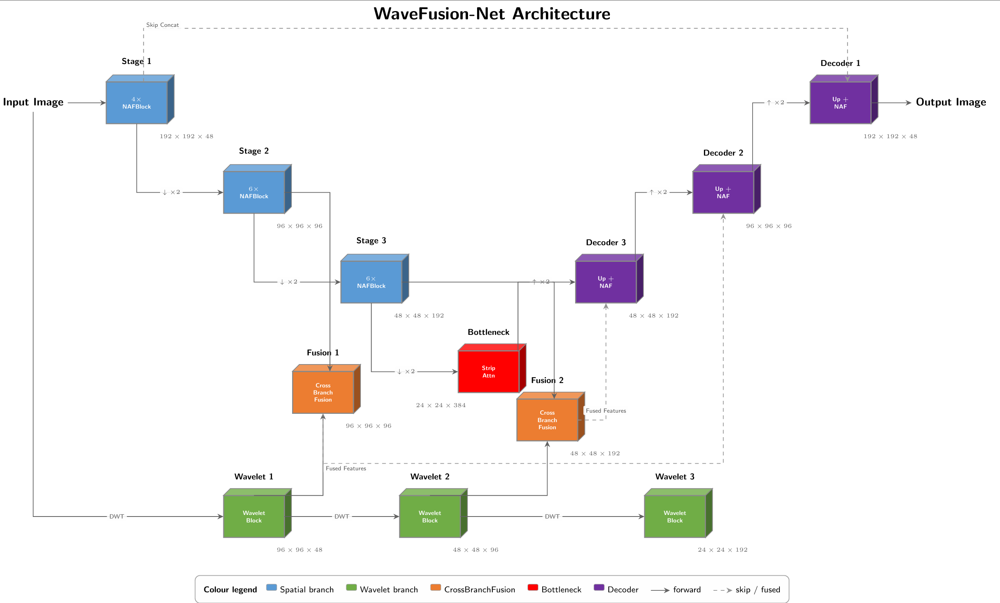
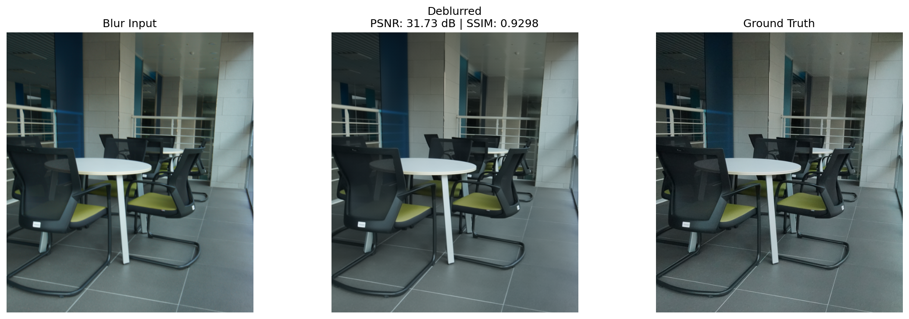
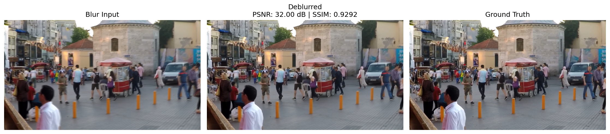
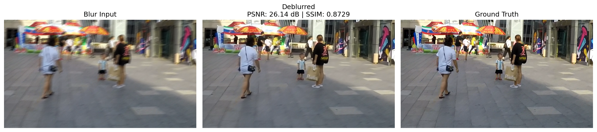
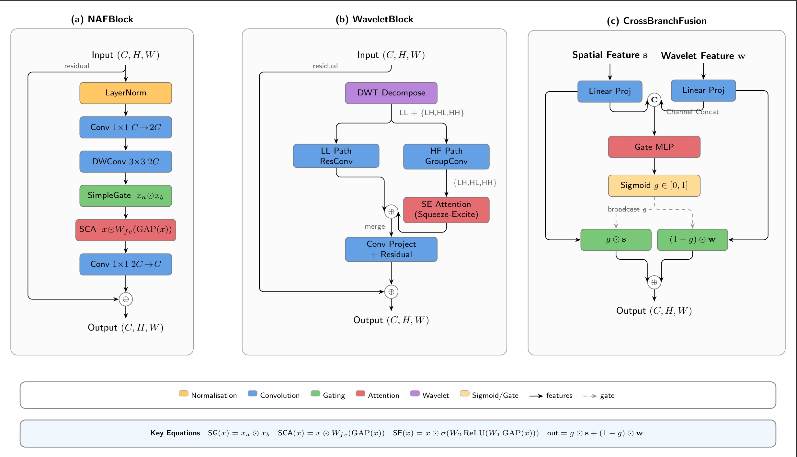

<h1 align="center">WaveFusion-Net</h1>

<p align="center">
  <b>Dual-Branch Spatial-Wavelet Fusion for Blind Image Deblurring</b><br/>
  IEEE NIGERCON 2026
</p>

<p align="center">
  
  
  
  
  
</p>

<p align="center">
  
</p>

WaveFusion-Net removes motion and camera-shake blur from a single photo. A NAFNet-style spatial CNN and a Haar-wavelet branch run side by side, and a small learned gate decides, at every pixel and channel, how much of each to trust. The model has **9.48M parameters** and was trained on **free Kaggle GPUs** (2x Tesla T4, 12-hour sessions).

## Highlights

- **Best score on RealBlur-J among the methods we compared: 29.57 dB / 0.8839 SSIM**, +0.61 dB over Restormer and +0.87 dB over MPRNet, with 2.7x fewer parameters than Restormer.
- **Leakage-free by construction.** A seeded 90/10 train/validation split, the checkpoint chosen on validation only, and the test set evaluated once. The SHA256 hash of every split is published and can be checked with one command.
- **Ablations, including the ones that did not help.** We removed the wavelet branch, the learned gate, StripAttention, and all four auxiliary losses, and report every result, including a null result for StripAttention.
- **Everything is a notebook.** Import one into Kaggle, attach the dataset, press *Run All*.

## Results

Baseline numbers are copied from the original papers. WaveFusion-Net numbers are single-run test scores.

### RealBlur-J (real camera blur, 980 test images)

| Method | PSNR (dB) | SSIM |
|---|---:|---:|
| MIMO-UNet+ | 27.63 | 0.837 |
| DeepDeblur | 27.87 | 0.827 |
| DMPHN | 28.42 | 0.860 |
| SRN | 28.56 | 0.867 |
| MPRNet | 28.70 | 0.873 |
| Restormer (26M params) | 28.96 | 0.879 |
| Uformer | 29.06 | n/a |
| **WaveFusion-Net (9.48M params)** | **29.57** | **0.8839** |

A second training seed on the same split gave **29.57 dB / 0.8841**, so the result is stable across two seeds.

### GoPro and HIDE: where it does not lead

| Dataset | WaveFusion-Net | Epochs | Strongest compared baseline |
|---|---:|---:|---|
| GoPro | 28.83 dB / 0.8754 | 100 | FFTformer 34.21 dB |
| HIDE | 28.93 dB / 0.8937 | 35 | FFTformer 31.62 dB |

On these two benchmarks the model trails the transformer baselines, and it is below DeepDeblur (29.08 dB) on GoPro. The comparison is not like for like: the baselines report 200 to 400 epochs on institutional clusters, while every run here fits inside one 12-hour Kaggle session. Validation PSNR was still rising when training stopped on both datasets. We treat this as a training-budget gap and have not shown otherwise, so we make no accuracy or efficiency claim on GoPro or HIDE.

### Qualitative results

Single test images. The PSNR and SSIM printed on each image belong to that image, not to the dataset average.

<p align="center"></p>
<p align="center"></p>
<p align="center"></p>

## Ablation study

Every variant uses the same seed, the same identical split, the same loss and the same epoch budget as the full model. A dash means the run was not performed.

| Variant | Params | GoPro PSNR / SSIM | RealBlur-J PSNR / SSIM |
|---|---:|---:|---:|
| **Full model** | 9.48M | **28.83 / 0.8754** | **29.57** / 0.8839 |
| Full model, training seed 7 | 9.48M | - | **29.57 / 0.8841** |
| Fixed-Fusion (no learned gate) | 9.39M | 28.79 / 0.8748 | 29.55 / **0.8841** |
| Spatial-Only (no wavelet branch) | 5.31M | 28.69 / 0.8730 | 29.53 / 0.8819 |
| No StripAttention | 9.18M | - | **29.57** / 0.8836 |
| L1-only loss | 9.48M | 28.28 / 0.8652 | 29.18 / 0.8775 |

What the numbers say:

- **The multi-term loss is the largest single contributor we measured:** L1-only costs 0.55 dB on GoPro and 0.39 dB on RealBlur-J. The four auxiliary terms were removed together, so this does not say which of them matters.
- **The wavelet branch helps** on both datasets (+0.14 dB GoPro, +0.04 dB RealBlur-J) at a cost of 4.2M extra parameters (9,484,659 vs 5,305,635).
- **The learned gate is a small gain** (+0.04 dB GoPro, +0.02 dB RealBlur-J) for 92,448 parameters, under 1% of the model. On RealBlur-J that is at the level of seed-to-seed noise.
- **StripAttention shows no measurable effect on RealBlur-J** (29.57 dB with and without it), and it accounts for 3.2% of the parameters.
- Every row is a single run except the full model on RealBlur-J, which has two seeds. HIDE was not ablated: one run takes about 11 hours.

## How it works

| Piece | What it does |
|---|---|
| **Spatial branch** | A U-shaped encoder-decoder of NAFBlocks (SimpleGate and Simplified Channel Attention, no activation functions), with 48 to 384 channels and (4, 6, 6, 4) blocks per level |
| **Wavelet branch** | A fixed, non-trainable 2x2 Haar transform splits features into LL, LH, HL and HH subbands, and WaveletBlocks process the smooth part and the three directional parts on separate paths |
| **CrossBranchFusion** | At two encoder scales a sigmoid gate `g` blends the two branches per channel and per location: `g*s + (1-g)*w` |
| **StripAttention** | Cheap 1x7 and 7x1 depthwise strip attention in the bottleneck, aimed at directional blur |
| **Loss** | `1.0 L1 + 0.1 VGG19 + 0.05 FFT + 0.1 Sobel gradient + 0.02 wavelet high-frequency` |
| **Output** | A dual residual: one at feature level, one at image level, so the network learns a correction to the blurry input |

The model has 9,484,659 parameters and needs 19.57 GMACs at 192x192.

<p align="center"></p>

## Reproducibility

**Protocol.** Each dataset's official training set is split 90/10 with seed 42. The best validation checkpoint is picked, and the test set is evaluated once at the end. Nothing about the test set touches any training decision.

**Split hashes.** Each run writes the SHA256 of its sorted train, validation and test file lists. The first 12 characters:

| Dataset | Train | Validation | Test |
|---|---|---|---|
| GoPro (1,893 / 210 / 1,111) | `7d659adfcd1f` | `063ab299a04b` | `7018c8b387e9` |
| HIDE (5,727 / 636 / 1,329) | `e62b33858f1b` | `34a1110dae60` | `e216a016ecbd` |
| RealBlur-J (3,383 / 375 / 980) | `af1027140302` | `8431800b03e0` | `2a98ebbf6075` |

Check that all 11 runs in this repository share these splits:

```bash
python scripts/verify_splits.py
```

**Training setup** (all runs): AdamW, learning rate 2e-4 with cosine decay to 1e-7, weight decay 1e-4, mixed precision (fp16), gradient clipping at 1.0, physical batch size 1 with 2 accumulation steps, 192x192 random crops with flips, seed 42. Epoch budgets are 100 (GoPro), 35 (HIDE) and 70 (RealBlur-J).

**Run the experiments.** Step-by-step instructions, the Kaggle dataset each notebook expects, the expected numbers and run times are in [`docs/REPRODUCE.md`](docs/REPRODUCE.md).

## Repository map

```
train/                 full-model notebooks: GoPro, HIDE, RealBlur-J (executed, with logs)
ablation/              Fixed-Fusion, Spatial-Only, and the interrupted-then-resumed RealBlur-J run
ablation/new_runs/     L1-only loss, No StripAttention, and the second-seed run
results/split_proofs/  SHA256 split proof of every run
results/ablation_json/ test evaluations and training histories
results/figures/       training curves and sample outputs for every run
scripts/               verify_splits.py
docs/                  REPRODUCE.md and the images used in this README
```

## Pretrained weights

The best-validation checkpoints of the three full models are attached to the **Releases** page (`wavefusion_gopro_best.pth`, `wavefusion_hide_best.pth`, `wavefusion_realblurj_best.pth`, about 114 MB each). Each file is a dictionary with the keys `model_state_dict`, `epoch`, `val_psnr` and `val_ssim`; load `model_state_dict` into the `WaveFusionNet` class defined in the notebooks under `train/`. The stored validation scores are 29.70 dB (GoPro, epoch 100), 26.45 dB (HIDE, epoch 35) and 30.08 dB (RealBlur-J, epoch 70).

## Honest notes

- Results are single runs, apart from the two-seed check on RealBlur-J. Run-to-run variation is small on RealBlur-J but is only measured there.
- The RealBlur-J Fixed-Fusion run was interrupted by a system sleep at epoch 50 and **resumed from the epoch-50 weights with a fresh AdamW state**. The two notebooks in `ablation/` are its two halves, and the split hashes were verified identical.
- Some ablations ran on a local RTX 5060 and the rest on Kaggle, so the notebooks carry outputs from both.
- The StripAttention ablation on GoPro is not included.

## Citation

```bibtex
@inproceedings{mamidala2026wavefusionnet,
  title     = {Dual-Branch Spatial-Wavelet Fusion for Blind Image Deblurring},
  author    = {Mamidala, Som Praneeth Babu and Reghunath, Lekshmi Chandrika and
               Imoize, Agbotiname Lucky and Tomazzoli, Claudio and Randieri, Cristian},
  booktitle = {IEEE NIGERCON},
  year      = {2026},
  note      = {to appear}
}
```

## Acknowledgements and license

Code is released under the [MIT License](LICENSE). The datasets keep their own licenses and are not redistributed here: GoPro (Nah et al., CVPR 2017), HIDE (Shen et al., ICCV 2019) and RealBlur (Rim et al., ECCV 2020). Baseline scores are taken from the original papers. All training was done on Kaggle's free GPU tier.
